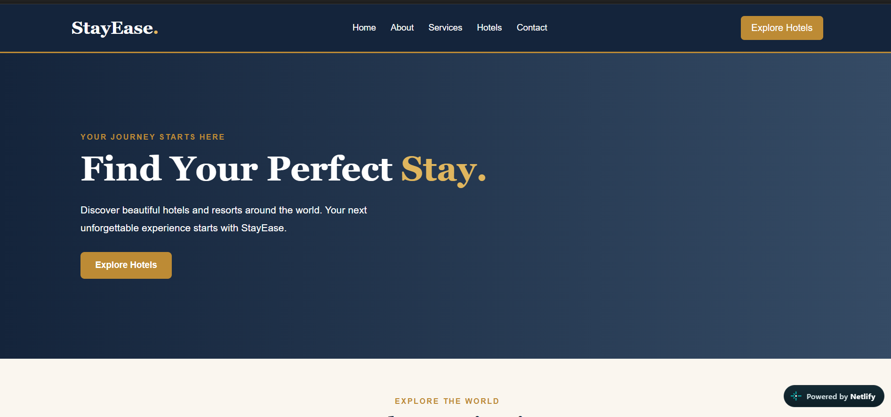
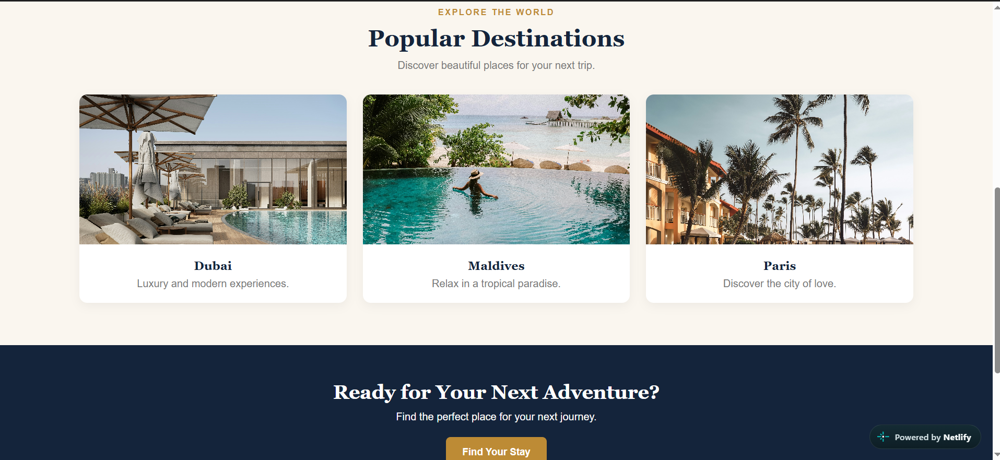
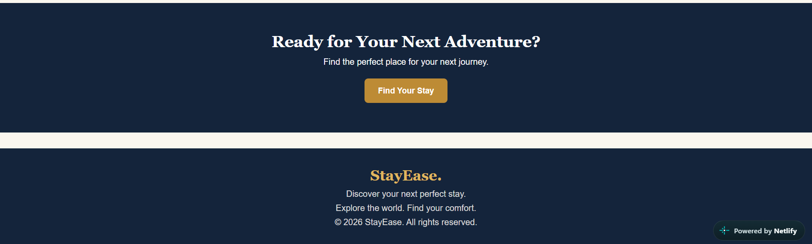
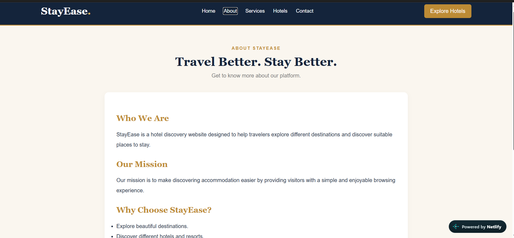
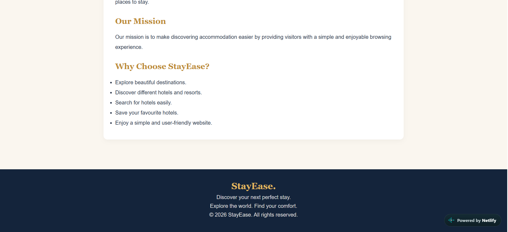
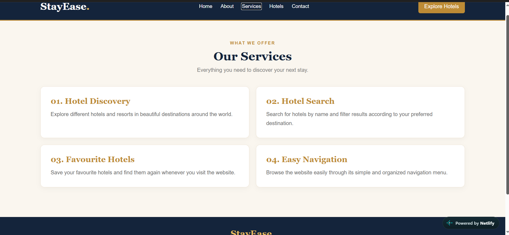
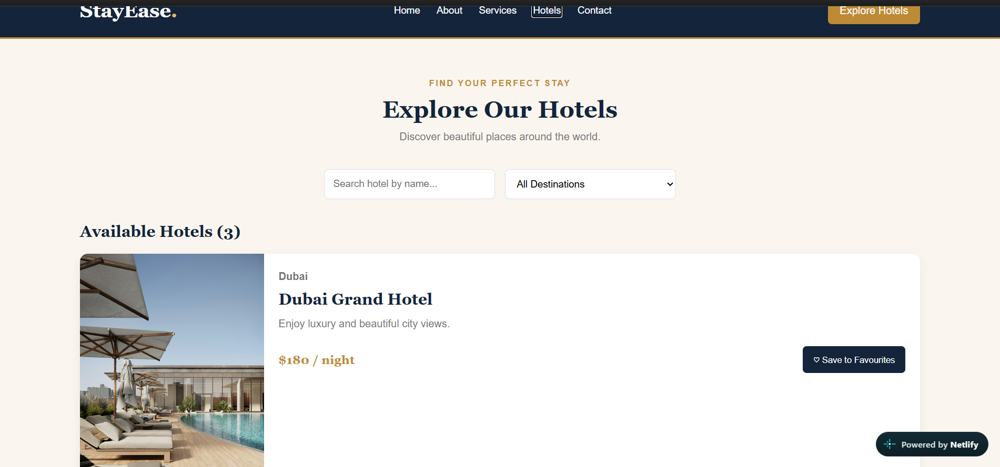
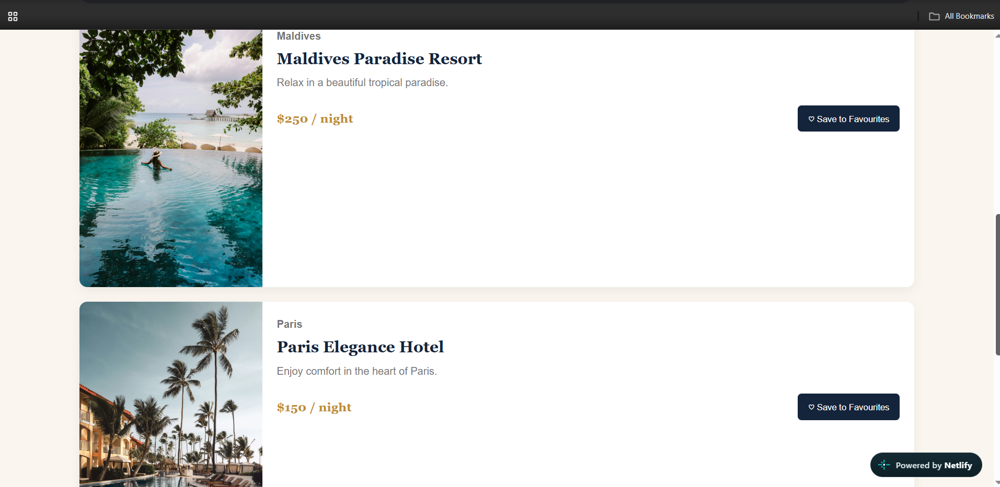
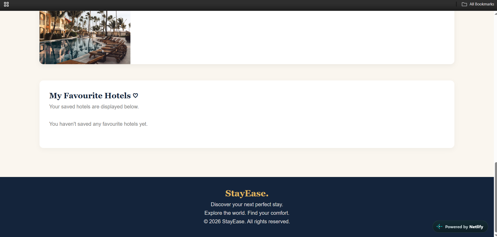
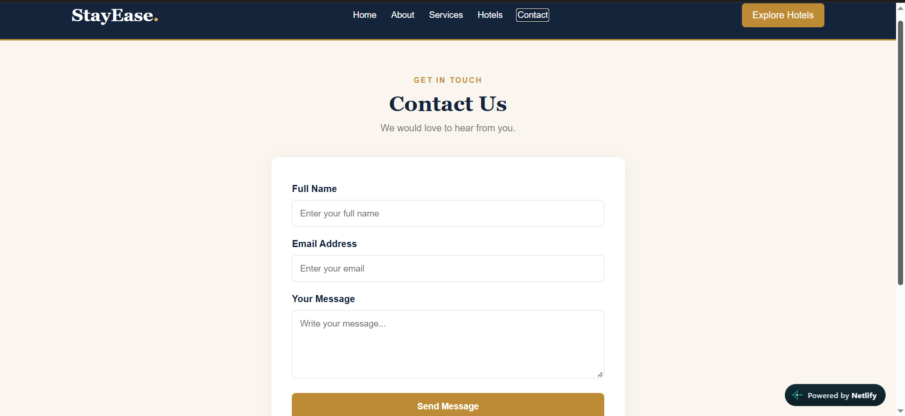

# StayEase

StayEase is a hotel discovery website built using React.

## Project Description

StayEase helps users discover hotels in different destinations and save their favourite hotels.

## Technologies Used

- React.js
- JavaScript
- HTML
- CSS
- React Router

## Website Pages

- Home
- About
- Services
- Hotels
- Contact

## Main Features

- Browse available hotels.
- Search hotels by name.
- Filter hotels by destination.
- Add hotels to favourites.
- Save favourites using localStorage.
- Contact form with input validation.

## Installation

1. Clone the repository.
2. Open the project folder.
3. Install dependencies:

   npm install

4. Start the application:

   npm start

## GitHub Repository

https://github.com/Diana12331642/StayEase

## Website Screenshots

### Home Page

### About Page

### Services Page

### Hotels Page

### Contact Page

